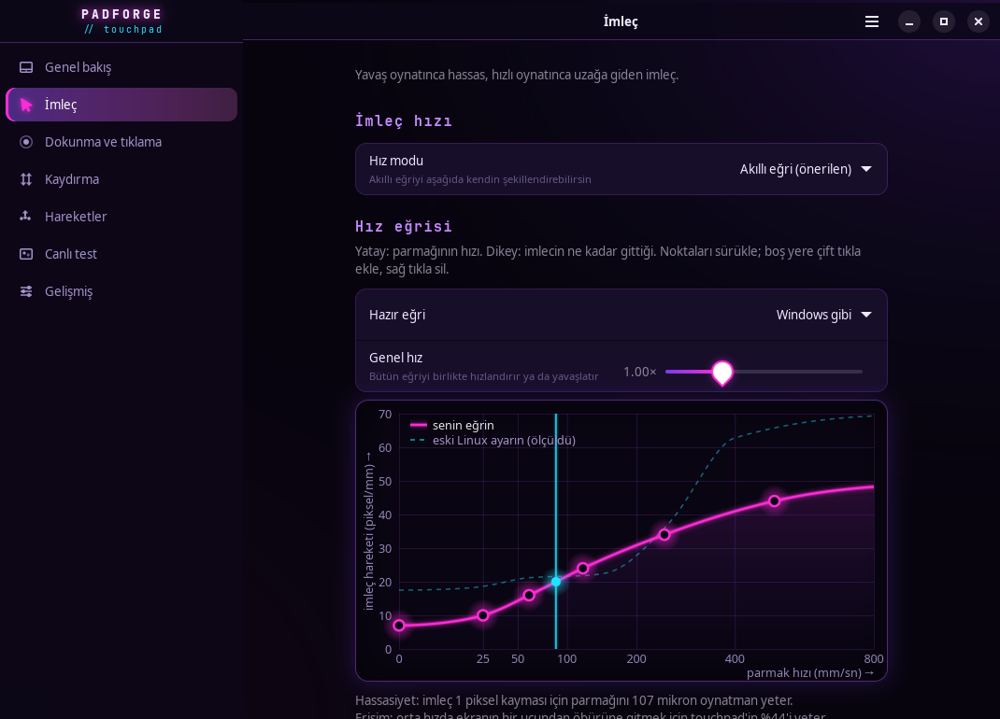
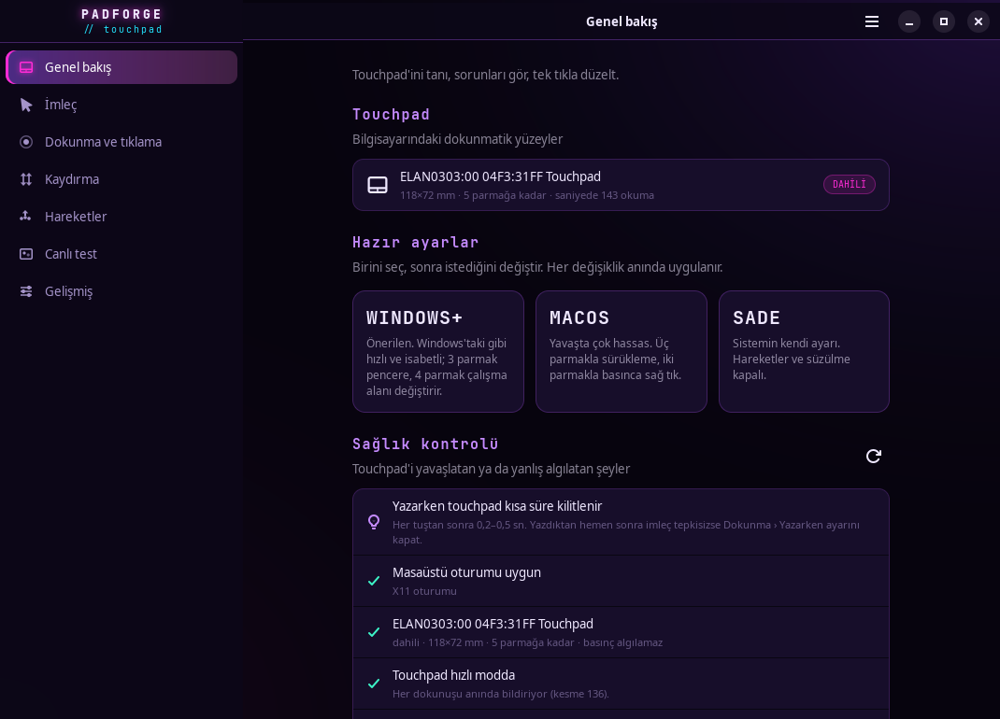
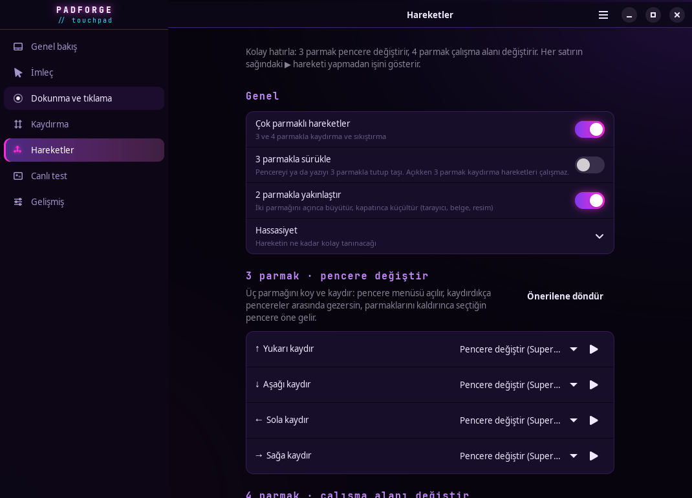
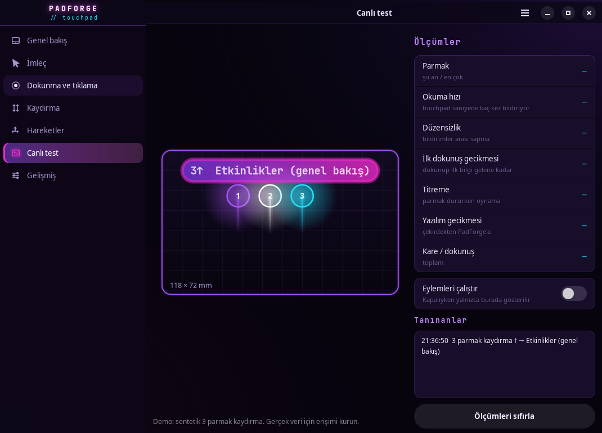

# PadForge

**Linux (X11) için Windows'tan daha iyi bir touchpad.** Ölçülmüş ivme eğrisi, gecikmesiz
dokunma, 3/4 parmak hareketler, kinetik kaydırma ve donanım teşhisi. Hepsi mor-siyah neon
temalı tek bir GTK4/libadwaita arayüzünden; değişiklikler anında uygulanır.



## Neden?

Aynı touchpad Windows'ta akıcı, Linux'ta "geciken, tam algılamayan" hissediyorsa sorun
genelde donanım değil, yazılım katmanlarıdır. PadForge bunları tek tek ölçüp düzeltir:

| Sorun (X11 / GNOME) | Ne oluyor | PadForge |
|---|---|---|
| Dokunarak tıklama gecikmesi | libinput, dokun-sürükle açıkken her tıklamanın bırakılmasını **180 ms** bekletir | Parmak kalktığı anda tıklayan kendi dokunma motoru (dokun-sürükle de çalışır) |
| Hareket yok | GNOME'un X11 oturumunda touchpad hareketi yoktur | 3/4 parmak kaydırma ve sıkıştırma, sürekli eylemler (uygulama değiştirici, ses), macOS tarzı 3 parmak sürükleme |
| Kaydırma atalet yok | X11 uygulamaları parmak kalkınca kaydırmayı sürdürmez | Parmağın kalkış hızını ölçüp yüksek çözünürlüklü tekerlekle yumuşakça devam ettirir |
| Ani ivme sıçraması | libinput "adaptive" eğrisi orta hızdan sonra birden ~3 kat hızlanır (aşağıdaki ölçüm) | Sürüklenebilir, sıçramasız hız eğrisi (Windows/macOS benzeri hazır eğriler) |
| İlk dokunuşta gecikme | I2C denetleyicisi 1 sn boşta kalınca uyur; ilk hareketi geciktirebilir | Ölçer (ilk rapor gecikmesi) ve tek tıkla uykuyu kapatır |
| Çift tıklama | Touchégg + libinput birlikte → her 2/3 parmak dokunuşta iki tık | Touchégg hareketlerini içe aktarır, Touchégg'i güvenle kapatır |

### Bu makinede ölçülenler

Sanal touchpad gerçek çekirdek → Xorg → libinput yolundan geçirilerek ölçüldü
(`padforge selftest`):

| Parmak hızı | libinput varsayılanı (hız 0.38) | PadForge "Windows benzeri" hedef | PadForge ölçülen |
|---|---|---|---|
| 20 mm/sn | 18.3 px/mm | 9.3 px/mm | 9.6 px/mm |
| 60 mm/sn | 21.2 px/mm | 16.0 px/mm | 15.8 px/mm |
| 150 mm/sn | 22.5 px/mm | 26.9 px/mm | 26.7 px/mm |
| 400 mm/sn | **62.8 px/mm** (sıçrama) | 40.9 px/mm | 41.0 px/mm |

Yavaş harekette iki kat daha hassas, hızlı harekette sıçramasız. libinput'un özel profili
açılınca iki parmak kaydırma normalde ~3 kat hızlanır; PadForge kaydırma eğrisini de yazarak
bunu dengeler (ölçülen 0.78 tık/mm = varsayılanla aynı).

## Özellikler

- **İmleç**: sürüklenebilir hız eğrisi (nokta ekle/sil), hazır eğriler, canlı "şu anki parmak hızın" göstergesi
- **Dokunma**: gecikmesiz motor, 1/2/3 parmak tık eşlemesi, dokun-sürükle, sürükleme kilidi,
  yazarken dokunma koruması, ince ayar (süre, kayma, pencereler)
- **Kaydırma**: hız, ivme, doğal/klasik, yatay, kinetik (sürtünme, güç, eşik)
- **Hareketler**: 3/4 parmak 4 yön, 3/4 parmak sıkıştırma, 4 parmak dokunma; 30'dan fazla eylem
  (genel bakış, çalışma alanı, uygulama değiştirici, masaüstü, pencere, sekme, ses, parlaklık,
  medya, yakınlaştırma, özel kısayol, özel komut). GNOME kısayolları gsettings'ten okunur.
- **Canlı test**: touchpad'in gerçek ölçekli görünümü, parmak izleri, tanınan hareketler,
  rapor hızı, ilk rapor gecikmesi, duran parmak titreşimi, okuma gecikmesi
- **Teşhis**: IRQ/polling modu, I2C uykusu, izinler, çakışan programlar, libinput sürücüsü
- **GNOME ile çift yönlü senkron**: GNOME Ayarlar'da değiştirdiğin şey PadForge'a da yansır
- **Touchégg'den geçiş**: hareketlerini içe aktarır; geri alınabilir şekilde kapatır

| Genel bakış | Hareketler | Canlı test |
|---|---|---|
|  |  |  |

## Kurulum

Ubuntu 24.04 (GNOME, X11) üzerinde geliştirildi ve test edildi. Gerekli paketler Ubuntu
masaüstünde genelde zaten kuruludur:

```bash
sudo apt install python3-gi gir1.2-gtk-4.0 gir1.2-adw-1 python3-evdev python3-xlib
```

```bash
./install.sh
```

Dosyalar `~/.local/share/padforge` altına kopyalanır, uygulama menüsüne **PadForge** eklenir ve
`padforge.service` (systemd kullanıcı servisi) başlatılır. İlk ayar, mevcut GNOME touchpad
ayarlarından oluşturulur: kurulum anında hissin değişmez.

Hareketler, gecikmesiz dokunma, kinetik kaydırma ve özel eğri için touchpad'in ham verisini
okuma izni gerekir (bir kez, yönetici olarak):

```bash
sudo bash ~/.local/share/padforge/install-udev.sh
```

Bu yalnızca `ID_INPUT_TOUCHPAD=1` olan aygıtlara, yalnızca masa başındaki oturum kullanıcısı
için okuma izni (ACL) veren bir udev kuralı ekler; klavyeye erişim vermez. İsteğe bağlı
`--power-fix` touchpad'in I2C denetleyicisinin uykusunu kapatır.

Touchégg kullanıyorsan: **Genel bakış › Sağlık kontrolü › Aktar ve kapat** (veya
`padforge import-touchegg --disable`). Touchégg çalıştığı sürece PadForge hareketleri ve
gecikmesiz dokunmayı kendiliğinden bekletir, böylece hiçbir şey iki kez tetiklenmez.

## Komut satırı

```text
padforge                 arayüz
padforge doctor          teşhis (ne bozuk, nasıl düzelir)
padforge measure         canlı ölçüm: rapor hızı, ilk rapor gecikmesi, titreşim
padforge selftest        sanal touchpad ile uçtan uca test (ekranı etkilemez)
padforge status          servis durumu (JSON)
padforge profile windows|macos|linux
padforge import-touchegg [--disable]   ·   padforge disable-touchegg / enable-touchegg
```

## Nasıl çalışır

```
 /dev/input/eventN ──evdev──► mt.py ──Frame (mm, zaman damgası)──┬─► gestures.py ─► actions.py ─► XTest / EWMH
   (ham çok-dokunuş)                                             ├─► tap.py ──────► XTest tık
                                                                 ├─► kinetic.py ──► uinput yüksek çözünürlüklü tekerlek
                                                                 └─► stats.py ────► teşhis / arayüz
 config.json ──► daemon.py ──► xinput.py ──► xf86-input-libinput özellikleri (eğri, kaydırma, tıklama…)
                    ▲  └────► gnome.py ───► org.gnome.desktop.peripherals.touchpad (çift yönlü)
 arayüz (GTK4) ─────┘ dosya izleme + JSON soket (durum, test, duraklat)
```

- **İvme eğrisi** libinput'un `custom` profiline yazılır. Ölçümle doğrulandı: bu profil cihaz
  birimiyle çalışır (1 birim/ms → 1 px/ms), bu yüzden eğri mm/sn → px/mm olarak tasarlanıp
  touchpad çözünürlüğüyle (birim/mm) kodlanır.
- **Kinetik kaydırma**, kalkış hızını çekirdek zaman damgalarıyla ölçer; mm'yi X kaydırma
  birimine dönüştürmek için o kaydırma sırasında Xorg'un gerçekten ürettiği oranı kullanır, bu
  yüzden hız, ivme ve doğal kaydırma ayarları kendiliğinden korunur.
- **Ayar çakışmaları**: mutter bir özelliği değiştirirse (aygıt yeniden bağlanınca vb.)
  servis birkaç milisaniye içinde kendi değerini geri yazar; başka bir program sürekli
  değiştiriyorsa döngüye girmeden durur ve uyarır.

## Testler

```bash
python3 -m pytest tests                                       # 194 birim testi
PADFORGE_INTEGRATION=1 python3 -m pytest tests/integration    # 10 test: gerçek Xorg + libinput
PADFORGE_GUI_DISPLAY=:7 python3 -m pytest tests/integration   # 6 arayüz testi (ör. Xephyr :7)
padforge selftest
```

Entegrasyon testleri `/dev/uinput` ile sanal touchpad/fare oluşturur ve X aygıtlarını
"yüzdürür", yani imleç ve pencereler etkilenmez. Arayüz testleri ayrı bir ekranda
(Xephyr) pencereyi açıp anahtar, profil, eğri ve kısayol düzenlemenin ayar dosyasına doğru
yazıldığını denetler.

## Kaldırma

```bash
~/.local/share/padforge/uninstall.sh          # ayarlar kalır; --purge ile onlar da silinir
sudo bash ~/.local/share/padforge/install-udev.sh --remove
```

Servis durdurulduğunda libinput'un kendi dokunarak tıklaması otomatik geri açılır.

## Sınırlar

- Şimdilik **yalnızca X11**. Wayland'de GNOME/KDE hareketleri kendileri sağlar; ivme eğrisi ve
  diğer özellikler için bileşik yöneticiye özel arka uç gerekir.
- Ubuntu 24.04, GNOME 46, xf86-input-libinput 1.4, libinput 1.25 ve ELAN0303 (I2C-HID)
  touchpad ile geliştirildi. Başka touchpad'lerde de çalışmalıdır (çözünürlük ve boyut
  çekirdekten okunur), ama ölçümler bu makineye aittir.

## English

PadForge is a touchpad tool for Linux/X11: a measured, drag-to-edit acceleration curve
(written to libinput's custom profile), a zero-latency tap engine (libinput delays every tap
by 180 ms when tap-and-drag is on), 3/4-finger swipes and pinches with continuous actions,
macOS-style three-finger drag, kinetic scrolling for X11 apps, live touch visualisation and
hardware diagnostics (report rate, I2C wake-up delay, noise). GTK4/libadwaita UI, systemd user
service, two-way GNOME settings sync, Touchégg migration. Install with `./install.sh`, then
`sudo bash ~/.local/share/padforge/install-udev.sh` once for raw touch access. MIT licensed.
